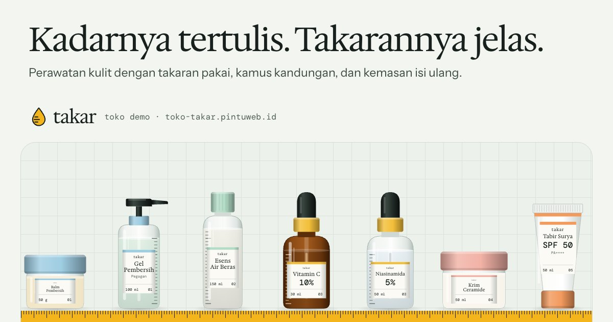

# Takar — Perawatan kulit berkadar jelas

Toko online demo untuk paket **Toko Online** PintuWeb. Takar adalah merek perawatan kulit fiktif dari Bandung yang menjual pembersih, toner, serum, pelembap, tabir surya, dan perawatan badan. Ciri khasnya: kadar bahan aktif tertulis di depan botol, takaran pakai di setiap halaman produk, dan kemasan isi ulang untuk produk yang paling cepat habis.

**Demo live:** https://toko-takar.pintuweb.id



> Takar adalah toko fiktif. Produk, formula, kadar, harga, stok, tarif ongkir, kebijakan, dan pesanan contoh semuanya rekaan, dan formulanya tidak pernah dibuat atau diuji. Tidak ada pembayaran sungguhan, tidak ada kurir sungguhan, dan tidak ada data yang dikirim ke server: keranjang, pesanan, rutinitas, perubahan stok, dan pesan kontak disimpan di `localStorage` browser pengunjung.

## Yang diperlihatkan

- **Penemu produk** (`/cocokkan`): empat pertanyaan (jenis kulit dari kondisi dua jam setelah cuci muka, kepekaan, sampai dua tujuan perawatan, ringkas atau lengkap). Hasilnya rutinitas pagi dan malam dengan alasan per produk; bahan kuat ditunda bila kulit sering bereaksi.
- **Penyusun rutinitas** (`/rutinitas`): pilih produk per langkah untuk pagi dan malam. Urutan otomatis (langkah, lalu dari yang paling encer), pemeriksaan bahan yang bentrok dan tabir surya, jadwal 7 malam bertanggal WIB untuk AHA, BHA, dan retinol, biaya per bulan, tautan untuk dibagikan, dan tombol masukkan semua ke keranjang.
- **Kamus kandungan** (`/kandungan`): 58 bahan yang benar-benar ada di daftar kandungan produk, termasuk pengawet dan pengatur pH. Fungsi, asal, kadar umum, catatan jujur tanpa janji medis, dan tautan balik ke produk. Daftar kandungan di halaman produk menaut ke entri kamus.
- **Halaman produk**: varian ukuran dan kemasan (botol atau isi ulang) dengan stok masing-masing, harga per ml, takaran pakai, pH, batas setelah dibuka (PAO), tekstur dan skala kekentalan, cara pakai, hal yang perlu diperhatikan, dan perkiraan kapan isi kemasan habis dibandingkan dengan PAO (misalnya vitamin C 30 ml tidak akan habis sebelum batas 3 bulan bila dipakai sekali sehari).
- **Isi ulang** (`/isi-ulang`): selisih harga per ml, cara mengisi ulang yang aman, alasan vitamin C, retinol, dan tabir surya tidak diisi ulang, dan contoh harga curah di toko.
- **Belanja**: katalog bersaring (langkah, jenis kulit, tujuan, waktu pakai, isi ulang, ramah kulit peka, harga, cari, urutan; tercermin di URL), keranjang, checkout dengan ongkir zona × berat atau ambil di toko, halaman pesanan dengan simulasi bayar dan faktur cetak, lacak dengan kode + 4 angka terakhir HP.
- **Dasbor demo** (`/admin`): penjualan hari ini dan 7 hari per tanggal WIB, grafik dengan tabel pengganti, status pesanan, pesan dari formulir kontak, stok menipis, editor stok per varian, sakelar jual, dan kembalikan data contoh.

## Identitas visual

- **Huruf:** Hedvig Letters Serif (judul), Instrument Sans (teks), DM Mono (kadar, ml, pH, INCI). Semua lewat `next/font`, variabel dipasang di `<html>`.
- **Warna:** ubin kamar mandi pagi (putih kehijauan), tinta hijau gelap, dan kunyit. Tiap langkah pakai punya warna tutup sendiri: biru air, hijau embun, kunyit, merah jambu, jingga, ungu lembut, dan hijau sereh.
- **Motif:** pita ukur kuning (bibir rak dan garis atas situs), garis takar yang tercetak di botol kaca, dinding ubin, olesan tekstur, dan piktogram takaran (tetes, pompa, seukuran kacang, dua ruas jari).
- **Ilustrasi kemasan** digambar dengan SVG di `components/Kemasan.js`: botol pipet kaca buram dan cokelat, botol pompa, botol toner, tabung, jar, kantong isi ulang dengan garis gunting, wadah dalam, tabung kertas, dan sabun batang. Ukuran varian ikut mengubah tinggi botol, dan label menghitung ukuran hurufnya sendiri supaya selalu muat.

## Model data

- `lib/data.js`: `site`, `langkah`, `jenisKulit`, `tujuan`, `produk` (INCI, bahan aktif dan kadarnya, pH, PAO, tekstur, takaran dalam ml, frekuensi, cara pakai, perhatian, kecocokan kulit, varian dengan harga, berat, dan stok), tarif ongkir, cara bayar, status pesanan, FAQ.
- `lib/kandungan.js`: kamus bahan; `bahanDariInci()` menautkan daftar kandungan produk ke kamus.
- `lib/katalog.js` (varian, stok, isi ulang, perkiraan habis, PAO, saringan), `lib/cocok.js` (skor penemu, usulan rutinitas, pemeriksaan, jadwal malam, biaya), `lib/pesanan.js`, `lib/ongkir.js`, `lib/format.js` (Rupiah, durasi, waktu WIB), `lib/store.js` (localStorage berversi `takar.*.v1`).

## Teknologi

- Next.js 15.5 (App Router) dan React 19, JavaScript
- Tailwind CSS v4 (`@theme` di `app/globals.css`)
- Gambar statis tanpa Image Optimization: varian WebP di `public/_img/` lewat `image-loader.js`. Setelah mengganti foto di `public/images`: `node scripts/static-images.mjs . --dirs public/images`

## Menjalankan secara lokal

```bash
npm install
npm run dev
```

Build produksi: `npm run build` lalu `npm start`. Pemeriksaan kode: `npm run lint`.

## Kredit foto

Foto bahan berlisensi CC0 1.0; daftar lengkap ada di [`public/images/SUMBER.md`](public/images/SUMBER.md).

---

Dibuat oleh [PintuWeb](https://www.pintuweb.id), jasa pembuatan website.
